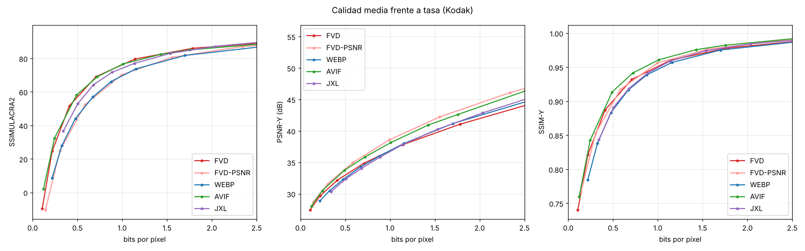

# Tesela

**Tesela** es un formato de imagen escrito desde cero en Rust. Divide cada imagen en *teselas*
de tamaño adaptativo, como un mosaico. A igual calidad ocupa menos que WebP y JPEG XL en todos los
tipos de contenido probados. Frente a AVIF gana con claridad en capturas de pantalla e
ilustraciones, gana en fotos pequeñas y empata en fotos grandes. Decodifica de 3 a 8 veces más
rápido que AVIF y funciona en cualquier navegador gracias a WebAssembly.

Admite canal alfa, modo sin pérdida y una vista previa progresiva opcional.

- **Comparador**: sube tus fotos y compáralas con WebP, AVIF, JPEG XL y JPEG, todo dentro del
  navegador (`web/compare/`).
- **Librería web**: `<tesela-img src="foto.tsl">`, con decodificación en paralelo en Web Workers
  (`web/tesela.js`).
- **Banco de pruebas reproducible** con BD-rate, curvas y datos crudos (`bench/`).

## Formato

La versión 1 del flujo de bits está **congelada**:

- [`docs/especificacion-v1.md`](docs/especificacion-v1.md) describe el contenedor, la sintaxis y
  la reconstrucción con el detalle necesario para escribir otro decodificador.
- [`tests/vectors/`](tests/vectors) contiene 14 archivos de conformidad con el hash de su salida,
  que se comprueban en nativo y en WebAssembly.
- Cada archivo lleva su número de versión: las mejoras futuras que cambien el flujo de bits irán
  en una versión nueva, y un `.tsl` v1 seguirá abriéndose.

## Pruébalo en tu ordenador

**Comparador con tus fotos.** Solo necesitas Git y Python 3; no hace falta Rust.

```sh
git clone -b ccr-17dbeae9-yi88ht https://github.com/davidpalmerojara/FVD.git tesela
cd tesela
python web/serve.py        # en macOS/Linux/WSL puede ser python3
```

Abre <http://localhost:8000/compare/> y arrastra tus fotos. Se procesan en tu navegador; nada sale
de tu ordenador. Tiene que ser a través de `http://`: abriendo el archivo directamente
(`file://`), el navegador bloquea WebAssembly y los workers.

- **Windows (PowerShell).** Se instala con `winget install Git.Git Python.Python.3.12`.
  Si `python` abre la Microsoft Store, usa `py web/serve.py`. Usa `web/serve.py` y no
  `python -m http.server`: en algunos Windows este último sirve los `.js` con un tipo incorrecto
  y el comparador no carga.
- **WSL.** Los mismos comandos que en Linux. Clona dentro de WSL (`~/tesela`), no en `/mnt/c`, y
  abre `http://localhost:8000/compare/` en el navegador de Windows: WSL 2 redirige localhost.

**Línea de comandos.** Necesita [Rust](https://rustup.rs) y acepta PNG y JPEG.

```sh
cargo build --release
./target/release/tesela encode foto.jpg foto.tsl -q 85      # comprimir
./target/release/tesela decode foto.tsl foto_decodificada.png
./target/release/tesela roundtrip foto.jpg -q 85            # tamaño y métricas en JSON
```

En PowerShell el ejecutable es `.\target\release\tesela.exe`. Compilar en Windows nativo
requiere las *Build Tools* de Visual Studio, que `rustup` ofrece instalar; en WSL basta con
`rustup` y `sudo apt install build-essential`.

## Resultados

**Qué se mide.** El BD-rate frente a WebP: el porcentaje medio de bytes que ahorra cada formato a
igual calidad (negativo = mejor). Todas las salidas se miden con el mismo programa de métricas.

**Datos de entrenamiento.** Las probabilidades iniciales de Tesela se entrenaron con BSD100 y con
imágenes sintéticas propias, nunca con las imágenes de evaluación.

### Por tipo de contenido (SSIMULACRA2, calidad perceptual)

| Conjunto | Tesela | AVIF | JPEG XL | Decodificación Tesela / AVIF |
|---|---|---|---|---|
| Kodak: 24 fotos de 768×512 | **−26,6 %** | −24,8 % | −12,1 % | 46 ms / 164 ms |
| Fotos grandes: 12 DIV2K de 2,7 MP | −29,2 % | **−30,2 %** | −21,2 % | 0,28 s / 2,36 s |
| Capturas de pantalla: 9 (código, documentación, terminal, hoja de cálculo, webs) | **−57,9 %** | −50,6 % | −36,0 % | 0,11 s / 0,18 s |
| Ilustraciones: 6 (emojis, vectorial, gráficos) | **−60,2 %** | −53,9 % | +9,5 % | 0,08 s / 0,09 s |

### Kodak, todas las métricas

| Formato | SSIMULACRA2 | SSIMULACRA2 alta calidad | PSNR-Y | SSIM-Y | PSNR RGB | Codificación | Decodificación |
|---|---|---|---|---|---|---|---|
| **Tesela** (por defecto) | **−26,6 %** | **−23,4 %** | **−17,7 %** | **−24,2 %** | **−22,8 %** | 1,06 s | **46 ms** |
| Tesela `--tune psnr` | −7,6 % | −7,6 % | −25,8 % | −20,3 % | −25,6 % | 1,07 s | 42 ms |
| AVIF (libavif 1.4 + aom, `speed=4`) | −24,8 % | −19,7 % | −16,4 % | −22,1 % | −17,4 % | 1,42 s | 164 ms |
| JPEG XL (libjxl 0.12, `effort=7`) | −12,1 % | −13,4 % | +9,4 % | +4,4 % | +12,2 % | 0,19 s | 146 ms |
| WebP (libwebp 1.6, `method=6`) | 0 % | 0 % | 0 % | 0 % | 0 % | 0,13 s | 115 ms |



**Cómo leer estos resultados:**

- **Fotos.** En Kodak, Tesela supera a AVIF en todas las columnas, aunque por poco en SSIMULACRA2
  (−2,5 % relativo). En fotos grandes hay **empate técnico**:
  - Tesela gana en SSIMULACRA2 de alta calidad (−25,8 % frente a −23,5 %), SSIM y PSNR RGB.
  - AVIF gana por ~1 punto en SSIMULACRA2 global y PSNR-Y.
  - **A tasas muy bajas (< 0,4 bpp), AVIF sigue siendo mejor.**
- **Contenido sintético.** Tesela supera a AVIF por 7 puntos en capturas e ilustraciones. Lo
  consigue con la paleta, la copia intra de bloques, el transform skip y la elección automática
  de 4:4:4.
- **Velocidad.** Tesela decodifica entre 3 y 8 veces más rápido que AVIF y, en fotos grandes,
  codifica 3,4 veces más rápido.
- **Calibración de la escala.** La escala de calidad imita la de JPEG: `-q 85` se ve parecido a un
  JPEG q85, y en las imágenes de la demo Tesela ocupa entre un 27 % y un 55 % menos.

Informes completos, con curvas y datos crudos:

- [Kodak](bench/results/REPORT.md)
- [fotos grandes](bench/results/fotos-grandes/REPORT.md)
- [capturas](bench/results/capturas/REPORT.md)
- [ilustraciones](bench/results/ilustraciones/REPORT.md)

### Sin pérdida

Tamaño total de 10 imágenes (3 fotos, 4 capturas y 3 ilustraciones):

| PNG optimizado | JPEG XL | WebP | Tesela |
|---|---|---|---|
| 3033 KB | 1960 KB | **1722 KB** | 2054 KB |

- **En capturas e ilustraciones** el modo sin pérdida de Tesela empata con WebP.
- **En fotos pierde:** ocupa un 21 % más que WebP y un 32 % más que JPEG XL, porque no tiene un
  predictor por píxel. Es la principal mejora pendiente de este modo.

## Diseño

| Etapa | Técnica |
|---|---|
| Contenedor | Cabecera y teselas independientes de 1024×1024 que se codifican y decodifican en paralelo (rayon en nativo, Web Workers en el navegador). En imágenes de hasta 1024 px no hay ninguna pérdida. |
| Color | YCbCr. Croma 4:2:0 centrado con interpolación bilineal, o 4:4:4 a calidades muy altas. |
| Partición | Superbloques de 64×64 divididos en un quadtree hasta 4×4. Cada decisión se toma por RDO (`D + λ·R`) con la tasa estimada a partir de los contextos reales. |
| Predicción | Planar, DC y 33 direcciones angulares con filtrado de referencias. Para croma también hay **CCLM**: la croma se predice desde la luma, con parámetros deducidos de los vecinos que no se transmiten. La búsqueda de modos se hace en dos fases. |
| Transformada | DCT-II ortonormal de 4 a 64 puntos: por producto de matrices en 4 y 8, y con el algoritmo rápido de Lee (O(n log n)) desde 16. Si el bloque solo tiene DC, se usa un atajo. |
| Cuantización | Matriz perceptual (`1 + s·r²`), cuantización adaptativa por actividad en celdas de 32×32 y **RDOQ**. |
| Entropía | Range coder binario con modelos de doble velocidad. Los coeficientes se codifican con `cbf`, `eob` y un barrido diagonal inverso con contextos que dependen del tamaño, la frecuencia y la plantilla de vecinos. Las **probabilidades iniciales están entrenadas**, con tablas por tipo de contenido (foto o sintético) y por banda de calidad. |
| Restauración | Filtro tipo ALF. Cada bloque 4×4 se clasifica en una de 12 clases (actividad × dirección). Cada clase tiene un filtro simétrico de 15 taps que el codificador estima por mínimos cuadrados y activa por superbloque. |
| Contenido sintético | Si la imagen parece sintética (pocos valores por bloque), el codificador activa tres herramientas, que en fotos no cuestan ni un bit. **Paleta**: hasta 8 colores, con índices codificados por rango según los vecinos. **Copia intra de bloques**: el codificador busca candidatos con un índice hash de bloques de 8×8. **Transform skip** en bloques de hasta 16×16. Además, el croma pasa a 4:4:4. |
| Alfa y sin pérdida | El alfa es un plano adicional sin pérdida con contextos propios. El modo sin pérdida codifica los planos G, B y R con residuo exacto, y predice B y R desde G con CCLM. |
| Vista previa | Opcional (`--preview`): una miniatura de ~300 bytes al principio del archivo. `<tesela-img>` la muestra desenfocada en cuanto llega, mientras se descarga el resto. |
| Determinismo | El decodificador WebAssembly produce **exactamente** los mismos bytes que el nativo, y lo comprueba el CI. |

Toda la sintaxis del bitstream se escribe una sola vez sobre un trait `Coder` con tres
implementaciones: codificar, decodificar y estimar coste. Así el codificador y el decodificador no
pueden desincronizarse.

```
src/rc.rs         codificador aritmético, modelos y binarizaciones
src/dct.rs        DCT rápida y SATD
src/predict.rs    predicción intra y CCLM
src/coeff.rs      codificación de coeficientes y RDOQ
src/restore.rs    filtro de restauración por clases
src/tools.rs      paleta, copia intra de bloques y detección de contenido sintético
src/codec.rs      contenedor, teselas, codificador (RDO) y decodificador
src/init_probs.rs probabilidades iniciales entrenadas (generado)
src/wasm.rs       interfaz WebAssembly (ABI C, sin bindgen)
src/metrics.rs    PSNR, SSIM y SSIMULACRA2
web/              librería JS, comparador, demo y codecs de referencia (vendor/)
bench/            banco de pruebas
```

## Diario de experimentos

Esta es la evolución medida con el BD-rate frente a WebP en SSIMULACRA2 y PSNR-Y, sobre 8 imágenes
de ajuste. Las filas con signo (+/−) son cambios respecto a la fila anterior. También recojo lo que
no funcionó.

| Cambio | SSIMULACRA2 | PSNR-Y | Resultado |
|---|---|---|---|
| Primera versión (quadtree hasta 32, 35 modos, RDOQ) | −4 % | −24 % | Base |
| Cuantización perceptual (matriz, AQ y croma) | −29 % | −4 % | Gran salto perceptual a costa de PSNR |
| Bloques de 64×64 | ±0 | ±0 | Se mantiene: no aporta en Kodak, pero ayuda en fotos grandes |
| AQ a 16×16 en vez de 32×32 | ±0 | −3 | Descartado |
| Mezcla logística de contextos (estilo PAQ) | −0,3 | −0,7 | **Descartado**: no compensa su coste |
| Poda de la partición por velocidad | −1 a −3 | | **Descartado**: cuesta calidad |
| Filtro Wiener separable | +0,3 | +1,4 | Superado por el siguiente |
| Filtro por clases (ALF, 12 clases) | +0,4 | +2,4 | **Adoptado** |
| Perfil equilibrado (búsqueda en rejilla) | −24,7 | −17,7 | Supera a AVIF en las cuatro, por márgenes mínimos |
| Probabilidades iniciales entrenadas con BSD100 | +1,7 | +0,8 | **Adoptado**: amplía el margen sobre AVIF |

En la validación con más tipos de contenido apareció el punto débil: en capturas, Tesela se
quedaba en −26 % frente al −51 % de AVIF. Estos cambios se midieron en las 9 capturas:

| Cambio en capturas | SSIMULACRA2 | Resultado |
|---|---|---|
| Croma 4:4:4 | −26 → −32 % | Se activa solo en contenido sintético |
| Paleta, copia de bloques y transform skip (sin entrenar) | → −55,8 % | **Adoptado**: supera a AVIF |
| Tablas entrenadas por tipo de contenido | → −57,9 % | **Adoptado** |

El análisis por herramienta muestra que la copia de bloques aporta casi todo: una hoja de cálculo
pasa de 110 KB a 31 KB. La paleta solo aporta ~1,5 %.

**Velocidad (perfilado con callgrind):**

- **Decodificación:** −28 % de instrucciones. Antes se ponían a cero búferes de 64×64 en cada
  bloque, incluso en los de 4×4. Además, el filtro de restauración se rehízo con un búfer con
  borde.
- **Codificación:** −40 % de tiempo con la SATD desenrollada, la DCT por matriz y la poda de
  candidatos. Ninguna de estas optimizaciones cambió la compresión.
- **SIMD en WebAssembly:** probado y **descartado**; no mejoraba nada.

## Uso

```sh
cargo build --release
./target/release/tesela encode foto.png foto.tsl -q 85
./target/release/tesela decode foto.tsl salida.png
./target/release/tesela compare foto.png salida.png     # métricas en JSON
./target/release/tesela roundtrip foto.png -q 85        # codifica, decodifica, verifica y mide
```

Opciones de `encode`:

| Opción | Efecto |
|---|---|
| `-q 1..100` | Calidad, en una escala parecida a la de JPEG. |
| `-e 1..9` | Esfuerzo de búsqueda. |
| `--tune balanced\|perceptual\|psnr` | Perfil de ajuste. |
| `--tile N` | Tamaño de las teselas en píxeles (múltiplo de 64). |
| `--420` / `--444` | Fuerza el submuestreo de croma. |
| `--no-restore` | Desactiva el filtro de restauración. |
| `--lossless` | Compresión sin pérdida. |
| `--preview` | Añade una vista previa progresiva (~300 bytes). |
| `--screen` / `--no-screen` | Fuerza o desactiva las herramientas de contenido sintético. |
| `--aq`, `--cq`, `--qm`, `--qmc`, `--lambda` | Ajustes finos. |

## En la web

```html
<script type="module" src="tesela.js"></script>
<tesela-img src="foto.tsl" alt="Descripción" fallback="foto.jpg" loading="lazy"></tesela-img>
```

```js
import { decode, encode, toObjectURL } from './tesela.js';
const imageData = await decode(bytes);                 // ImageData
const tsl = await encode(imageData, { quality: 85 });  // codificar en el navegador
const url = await toObjectURL(bytes);                  // para cualquier 
```

- **Tamaño del módulo.** `web/tesela.wasm` pesa 515 KB e incluye el codificador, el
  decodificador y las métricas.
- **Paralelismo.** La librería reparte las teselas entre varios Web Workers.
- **Recompilar.** `web/build.sh` regenera el módulo (necesitas
  `rustup target add wasm32-unknown-unknown`).

Para probarlo en local:

```sh
python3 web/serve.py
# http://localhost:8000/            portada
# http://localhost:8000/compare/    comparador
# http://localhost:8000/demo/       demo de <tesela-img>
```

El workflow `.github/workflows/pages.yml` publica `web/` en GitHub Pages. Hay que activarlo una
vez en *Settings → Pages → Source: GitHub Actions*.

### Comparador

Sube fotos y elige uno de dos modos:

- **Misma calidad.** Cada formato se codifica varias veces hasta rodear un objetivo de
  SSIMULACRA2. El tamaño se interpola en ese punto exacto para que ningún formato salga
  perjudicado por pasarse del objetivo.
- **Calidad fija.** Cada formato usa la calidad que le indiques.

Muestra tamaño, métricas y tiempos, y tiene un visor con cortina y zoom para comparar dos formatos
cualquiera, además de descargas de cada archivo. Los códecs de referencia son las bibliotecas
oficiales compiladas a WebAssembly ([jSquash](https://github.com/jamsinclair/jSquash), Apache-2.0,
incluidas en `web/vendor/`) y se ejecutan con un hilo por formato. Nada sale del navegador.

## Banco de pruebas

```sh
pip install -r bench/requirements.txt   # Pillow (WebP y AVIF), imagecodecs (libjxl 0.12), numpy, scipy, matplotlib
bench/fetch_kodak.sh
python3 bench/bench.py                  # Kodak, todos los códecs
bench/fetch_div2k.sh && python3 bench/bench.py --images bench/data/div2k --out bench/results/fotos-grandes
cargo doc --no-deps && node bench/gen_synthetic.js bench/data   # capturas e ilustraciones
python3 bench/bench.py --images bench/data/screen --out bench/results/capturas
python3 bench/bench.py --codecs tesela --reuse --tesela-args "--aq 1.5"   # iterar solo Tesela
```

Para reentrenar las probabilidades iniciales (con imágenes que no sean las de evaluación):

```sh
./target/release/tesela train src/init_probs.rs entrenamiento/*.png
```

## Limitaciones

- **Soporte nativo.** Ningún navegador ni sistema operativo lo soporta de forma nativa: hace falta
  `tesela.js` y WebAssembly (515 KB). Conviene servir un `fallback` en JPEG.
- **Fotos a tasas bajas.** Por debajo de ~0,4 bpp AVIF sigue siendo mejor. En fotos grandes la
  compresión está empatada con AVIF.
- **Sin pérdida en fotos.** Ocupa más que WebP y JPEG XL.
- **Formato de los datos.** Solo admite 8 bits por canal, y el canal alfa siempre es sin pérdida
  (un alfa con degradados suaves cuesta bastante). No tiene animación ni metadatos ICC o EXIF.
- **Velocidad de codificación.** En capturas, codificar es más lento (~5 s por imagen de 1,3 MP).
- **Licencias de los datos.** Las imágenes de prueba (Kodak, DIV2K) y de entrenamiento (BSD100) no
  se redistribuyen, salvo `web/compare/sample.png` (kodim23). Las capturas e ilustraciones se
  generan con `bench/gen_synthetic.js`.
