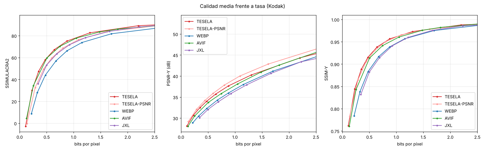

[Español](README.es.md) · **English**

# Tesela

**Tesela** is an image format written from scratch in Rust. It splits each image into *tiles*
(*teselas* in Spanish) of adaptive size, like a mosaic. In the benchmarks below (equal SSIMULACRA2,
BD-rate) it is smaller than WebP, AVIF and JPEG XL on every content type tested: small and large photos, screenshots and illustrations. On
photos it decodes 3 to 4 times faster than AVIF, and it works in any browser thanks to
WebAssembly.

It supports an alpha channel, a lossless mode and an optional progressive preview.

It is an independent, experimental project: not a standard, and no browser supports it natively
(it is decoded with WebAssembly). The encoder is slower than JPEG XL's or WebP's.

**Website and online comparator: [tesela.davidpalmero.dev](https://tesela.davidpalmero.dev/)**
([comparator](https://tesela.davidpalmero.dev/compare/)).

- **Comparator**: upload your photos and compare them against WebP, AVIF, JPEG XL and JPEG, all
  inside the browser (`web/compare/`).
- **Web library**: `<tesela-img src="photo.tsl">`, with parallel decoding in Web Workers
  (`web/tesela.js`).
- **Reproducible benchmark** with BD-rate, curves and raw data (`bench/`).

## Format

Version 1 of the bitstream is **frozen**:

- [`docs/especificacion-v1.md`](docs/especificacion-v1.md) (in Spanish) describes the container, the
  syntax and the reconstruction in enough detail to write another decoder.
- [`tests/vectors/`](tests/vectors) contains 14 conformance files with the hash of their output,
  which are checked natively and in WebAssembly.
- Every file carries its version number: future improvements that change the bitstream will go
  into a new version, and a v1 `.tsl` will keep opening.

**Version 2** is under development and is what the encoder writes by default (`--v1` writes v1). It
adds rectangular partitions and new probability tables. Its differences from v1 are in
[`docs/especificacion-v2-borrador.md`](docs/especificacion-v2-borrador.md) (in Spanish). Until it is
frozen, it may change.

## Downloads

Ready-made binaries, no Rust needed, are on the
[Releases page](https://github.com/davidpalmerojara/tesela/releases):

- **Desktop app** (viewer and converter for `.tsl`: open with a double click, play animations,
  save as PNG, convert PNG/JPEG/GIF/WebP by dragging them in): Windows installer (`.exe`/`.msi`),
  macOS (`.dmg`, Apple Silicon and Intel) and Linux (`.deb`, `.AppImage`). See
  [`desktop/README.md`](desktop/README.md) (in Spanish).
- **Command line** (`tesela encode` / `decode`) for Linux x86-64, Windows x86-64 and macOS
  (Apple Silicon and Intel), with `SHA256SUMS.txt` to check the downloads.

The apps are **not code-signed**. On Windows, SmartScreen will warn you: click *More info → Run
anyway*. On macOS, right-click the app → *Open* (on macOS 15+, *System Settings → Privacy &
Security → Open Anyway*), or run `xattr -dr com.apple.quarantine /Applications/Tesela.app`.

## Try it on your computer

**Comparator with your photos.** You only need Git and Python 3; Rust is not required.

```sh
git clone https://github.com/davidpalmerojara/FVD.git tesela
cd tesela
python web/serve.py        # on macOS/Linux/WSL it may be python3
```

Open <http://localhost:8000/compare/> and drag in your photos. They are processed in your browser;
nothing leaves your computer. It must be served over `http://`: if you open the file directly
(`file://`), the browser blocks WebAssembly and workers.

**Log.** With `web/serve.py`, every photo the comparator finishes is saved in `registro/` (the
original, the tested image after downscaling, and the results for each format). You can browse it at
<http://localhost:8000/registro/>, with a filter to show only the cases where Tesela does not win, and
you can summarize it or re-run it with the native codecs (all metrics, photo by photo):

```sh
python bench/registro.py                   # summary of what was tested in the browser
python bench/registro.py --banco           # re-runs the images with the native codecs
```

`registro/` is not committed to Git (it holds your photos). To share it: `git add -f registro` and a
commit, bearing in mind that if the repository is public, the photos will be public too; or zip it
and send it.

- **Windows (PowerShell).** Install with `winget install Git.Git Python.Python.3.12`.
  If `python` opens the Microsoft Store, use `py web/serve.py`. Use `web/serve.py` rather than
  `python -m http.server`: on some Windows setups the latter serves `.js` files with the wrong type
  and the comparator does not load.
- **WSL.** The same commands as on Linux. Clone inside WSL (`~/tesela`), not in `/mnt/c`, and
  open `http://localhost:8000/compare/` in the Windows browser: WSL 2 forwards localhost.

**Command line.** It needs [Rust](https://rustup.rs) and accepts PNG and JPEG.

```sh
cargo build --release
./target/release/tesela encode photo.jpg photo.tsl -q 85      # compress
./target/release/tesela decode photo.tsl decoded_photo.png
./target/release/tesela roundtrip photo.jpg -q 85             # size and metrics as JSON
```

In PowerShell the executable is `.\target\release\tesela.exe`. Building on native Windows
requires the Visual Studio *Build Tools*, which `rustup` offers to install; on WSL, `rustup` and
`sudo apt install build-essential` are enough.

## Results

**What is measured.** BD-rate against WebP: the average percentage of bytes each format saves at
equal quality (negative = better). All outputs are measured with the same metrics program.

**Training data.** Tesela's initial probabilities were trained on BSD100 and on our own synthetic
images, never on the evaluation images.

### By content type (SSIMULACRA2, perceptual quality)

| Set | Tesela | AVIF | JPEG XL | Decoding Tesela / AVIF |
|---|---|---|---|---|
| **CLIC 2020**: 41 professional photos of 2.2 MP (reference set in research) | **−39.3%** | −29.6% | −22.2% | 0.51 s / 1.46 s |
| Kodak: 24 photos of 768×512 | **−33.3%** | −26.3% | −12.1% | 58 ms / 256 ms |
| **DIV2K**: 50 validation photos of 2.7 MP ([report](bench/results/div2k-50/REPORT.md), in Spanish) | **−38.9%** | −34.4% | −20.3% | 0.63 s / 1.88 s |
| Screenshots: 9 (code, documentation, terminal, spreadsheet, web pages) | **−61.0%** | −54.3% | −36.0% | 0.14 s / 0.15 s |
| Illustrations: 6 (emoji, vector art, charts) | **−64.2%** | −56.0% | +9.5% | 0.11 s / 0.10 s |

AVIF with full chroma (4:4:4): on every set it is smaller than with 4:2:0, by 2 to 7% at medium
quality and considerably more at high quality, so it is the fair comparison. Tesela chooses 4:2:0 or
4:4:4 per image. Against AVIF at 4:2:0, Tesela's advantage looked larger (on DIV2K, −34.0 versus
−32.5%; now −38.9 versus −34.4%). Timings are those of the benchmark, which encodes and decodes four
images at a time. The Kodak timings were taken on an idle machine; those of the other sets were taken
with the machine shared with other tasks, so the Tesela figures are pessimistic.

### Kodak, all metrics

| Format | SSIMULACRA2 | SSIMULACRA2 high quality | PSNR-Y | SSIM-Y | PSNR RGB | Encoding | Decoding |
|---|---|---|---|---|---|---|---|
| **Tesela** (default) | **−33.3%** | **−30.2%** | −21.6% | **−28.9%** | −31.6% | 1.90 s | **58 ms** |
| Tesela `--tune psnr` | −20.1% | −18.6% | **−30.1%** | −26.4% | **−35.2%** | 2.04 s | 64 ms |
| AVIF (libavif 1.4 + aom, `speed=4`, 4:4:4) | −26.3% | −22.4% | −12.9% | −19.3% | −20.5% | 2.50 s | 256 ms |
| JPEG XL (libjxl 0.12, `effort=7`) | −12.1% | −13.4% | +9.4% | +4.4% | +12.2% | 0.19 s | 146 ms |
| WebP (libwebp 1.6, `method=6`) | 0% | 0% | 0% | 0% | 0% | 0.13 s | 115 ms |



**How to read these results:**

- **Photos.** On SSIMULACRA2, Tesela beats AVIF by 7 points on Kodak, almost 10 on CLIC and 4.5 on
  the large DIV2K photos. On PSNR-Y (luma only) the advantage is smaller, because by choosing 4:4:4
  Tesela spends more bits on color; on PSNR RGB, it is larger.
- **Synthetic content.** Tesela beats AVIF by 7-8 points on screenshots and illustrations. It gets
  there with the palette, intra block copy, transform skip and automatic selection of 4:4:4.
- **Speed.** On photos, Tesela decodes 3 to 4 times faster than AVIF (58 versus 256 ms per Kodak
  photo); on screenshots, the same; on illustrations, slightly slower (0.11 versus 0.10 s).
  Encoding is faster than AVIF (speed 4) on photos: 1.9 versus 2.5 s per Kodak photo; on
  illustrations, slower. JPEG XL and WebP encode 10 to 20 times faster. The benchmark timings are for
  one image per core; the encoder uses all cores for a single image.
- **Scale calibration.** The quality scale mimics JPEG's: `-q 85` looks similar to a JPEG q85, and on
  the demo images Tesela is between 27% and 55% smaller.

Full reports, with curves and raw data (in Spanish):

- [Kodak](bench/results/REPORT.md)
- [large photos](bench/results/fotos-grandes/REPORT.md)
- [screenshots](bench/results/capturas/REPORT.md)
- [illustrations](bench/results/ilustraciones/REPORT.md)

### Lossless

Total size of 10 images (3 photos, 4 screenshots and 3 illustrations):

| Optimized PNG | JPEG XL | WebP | Tesela |
|---|---|---|---|
| 3033 KB | 1960 KB | **1722 KB** | 2054 KB |

- **On screenshots and illustrations** Tesela's lossless mode ties with WebP.
- **On photos it loses:** it is 21% larger than WebP and 32% larger than JPEG XL, because it has no
  per-pixel predictor. This is the main pending improvement for this mode.

## Design

| Stage | Technique |
|---|---|
| Container | Header and independent 1024×1024 tiles that are encoded and decoded in parallel (rayon natively, Web Workers in the browser); within each tile, the encoder decides the superblocks in a multithreaded wavefront. For images up to 1024 px there is no tiling loss at all. |
| Color | YCbCr. Centered 4:2:0 chroma with bilinear interpolation, or 4:4:4 when subsampling would erase color detail that the requested quality preserves (the encoder measures this for each image). |
| Partitioning | 64×64 superblocks split in a quadtree down to 4×4. In v2, each node that is not split into four can be split into two rectangular halves (horizontal or vertical). Every decision is made by RDO (`D + λ·R`) with the rate estimated from the real contexts. |
| Prediction | Planar, DC and 33 angular directions with reference filtering. For chroma there is also **CCLM**: chroma is predicted from luma, with parameters derived from the neighbors that are not transmitted. Mode search is done in two phases. |
| Transform | Orthonormal DCT-II from 4 to 64 points: by matrix product at 4 and 8, and with Lee's fast algorithm (O(n log n)) from 16. If the block has only DC, a shortcut is used. |
| Quantization | Perceptual matrix (`1 + s·r²`), activity-adaptive quantization in 32×32 cells, and **RDOQ**. |
| Entropy | Binary range coder with dual-rate models. Coefficients are coded with `cbf`, `eob` and a reverse diagonal scan, with contexts that depend on size, frequency and the neighbor template. The **initial probabilities are trained**, with tables per content type (photo or synthetic) and per quality band. |
| Restoration | ALF-style filter. Each 4×4 block is classified into one of 12 classes (activity × direction). Each class has a symmetric 15-tap filter that the encoder estimates by least squares and enables per superblock. |
| Synthetic content | If the image looks synthetic (few distinct values per block), the encoder enables three tools, which cost not a single bit on photos. **Palette**: up to 8 colors, with indices coded by rank according to the neighbors. **Intra block copy**: the encoder searches for candidates with a hash index of 8×8 blocks. **Transform skip** on blocks up to 16×16. In addition, chroma switches to 4:4:4. |
| Alpha and lossless | Alpha is an additional lossless plane with its own contexts. Lossless mode codes the G, B and R planes with an exact residual, and predicts B and R from G with CCLM. |
| Animation (v2) | A canvas and a list of frames, each with its duration and the rectangle that changes. Each block can be predicted from the previous frame with a quarter-pixel motion vector or with the frame's global motion (affine, for pans and zooms), relative to the previous frame or to a long-term reference (the key frame). `tesela encode` accepts animated GIF, APNG and WebP; `tesela decode` writes a GIF (`output.gif`) or one PNG per frame (`folder/`). On the web, `<tesela-img>` plays it and the Service Worker delivers it as APNG, so `` animates. |
| Metadata (v2) | ICC color profile (for example, the Display P3 of phone photos) and EXIF. When encoding, the EXIF orientation is applied to the pixels. `tesela decode` writes the profile into the PNG, and the Service Worker includes it in the PNG it delivers to the browser, which handles color as with any other image. `--sin-metadatos` does not store them. |
| Preview | Optional (`--preview`): a thumbnail of ~300 bytes at the start of the file. `<tesela-img>` shows it blurred as soon as it arrives, while the rest downloads. |
| Determinism | The WebAssembly decoder produces **exactly** the same bytes as the native one, and CI checks it. |

All of the bitstream syntax is written once over a `Coder` trait with three implementations: encode,
decode and estimate cost. This way the encoder and the decoder cannot get out of sync.

```
src/rc.rs         arithmetic coder, models and binarizations
src/dct.rs        fast DCT and SATD
src/predict.rs    intra prediction and CCLM
src/coeff.rs      coefficient coding and RDOQ
src/restore.rs    class-based restoration filter
src/tools.rs      palette, intra block copy and synthetic content detection
src/codec.rs      container, tiles, encoder (RDO) and decoder
src/init_probs.rs trained initial probabilities (generated)
src/wasm.rs       WebAssembly interface (C ABI, no bindgen)
src/metrics.rs    PSNR, SSIM and SSIMULACRA2
web/              JS library, comparator, demo and reference codecs (vendor/)
bench/            benchmark
```

## Experiment log

This is the evolution measured as BD-rate against WebP on SSIMULACRA2 and PSNR-Y, over 8 tuning
images. Rows with a sign (+/−) are changes relative to the previous row. I also record what did not
work.

| Change | SSIMULACRA2 | PSNR-Y | Result |
|---|---|---|---|
| First version (quadtree up to 32, 35 modes, RDOQ) | −4% | −24% | Baseline |
| Perceptual quantization (matrix, AQ and chroma) | −29% | −4% | Big perceptual jump at the cost of PSNR |
| 64×64 blocks | ±0 | ±0 | Kept: no gain on Kodak, but helps on large photos |
| AQ at 16×16 instead of 32×32 | ±0 | −3 | Discarded |
| Logistic context mixing (PAQ style) | −0.3 | −0.7 | **Discarded**: not worth its cost |
| Speed-based partition pruning | −1 to −3 | | **Discarded**: costs quality |
| Separable Wiener filter | +0.3 | +1.4 | Superseded by the next one |
| Class-based filter (ALF, 12 classes) | +0.4 | +2.4 | **Adopted** |
| Balanced profile (grid search) | −24.7 | −17.7 | Beats AVIF on all four, by minimal margins |
| Initial probabilities trained on BSD100 | +1.7 | +0.8 | **Adopted**: widens the margin over AVIF |

Validation with more content types exposed the weak point: on screenshots, Tesela stood at −26%
against AVIF's −51%. These changes were measured on the 9 screenshots:

| Change on screenshots | SSIMULACRA2 | Result |
|---|---|---|
| 4:4:4 chroma | −26 → −32% | Enabled only on synthetic content |
| Palette, block copy and transform skip (untrained) | → −55.8% | **Adopted**: beats AVIF |
| Tables trained per content type | → −57.9% | **Adopted** |

The per-tool analysis shows that block copy contributes almost everything: a spreadsheet goes from
110 KB to 31 KB. The palette contributes only ~1.5%.

**Speed (profiled with callgrind):**

- **Decoding:** −28% instructions. Previously, 64×64 buffers were zeroed for every block, even
  4×4 ones. In addition, the restoration filter was redone with a bordered buffer.
- **Encoding:** −40% time with unrolled SATD, matrix-based DCT and candidate pruning. None of these
  optimizations changed compression.
- **SIMD in WebAssembly:** tried and **discarded**; it did not improve anything.

**Version 2: rectangular partitions** (Kodak-8, BD-rate against WebP on SSIMULACRA2):

| Change | SSIMULACRA2 | Result |
|---|---|---|
| Baseline (quadtree only) | −28.4% | |
| 2:1 rectangular halves at all sizes, with RDO | −29.7% | Clear improvement |
| No rectangles on 64×64 nodes (pruning A) | −29.9% | **Adopted**: equal or better, with less search |
| Multiple transforms (MTS style) | no net gain | **Discarded** |
| Probability tables trained on DIV2K | no net gain | **Discarded**; BSD100 and synthetic images are still used |
| Trained v2 tables (including the new contexts) | −0.2 to −0.3% on validation crops | **Adopted** |
| Dependent quantization (4-state trellis, as in VVC), with retrained tables | Kodak −29.8% (same); crops: +0.8% at low quality, −0.8% at high | **Discarded**: neutral on average and 25% slower. Our RDOQ was already tight and SSIMULACRA2 is not squared error |
| Psychovisual RDO (penalizing the AC energy difference, like x264's `psy-rd`) | from +2% (weak) to +32% (strong) at low quality | **Discarded**: SSIMULACRA2 measures structure, and forcing texture makes it worse |

**Adaptive 4:4:4 chroma.** A user's photos with fine color detail (facades, fabrics, vegetation)
stayed at SSIMULACRA2 ~80 with 4:2:0, and there JPEG XL won. Now the encoder measures how much error
subsampling would add and, if it is large relative to the quantization step, stores the full chroma
(without changing the format: the field already existed):

| Change | Result |
|---|---|
| 4:4:4 when the subsampling error exceeds 0.25 × the step | User photos: Tesela now beats JPEG XL on 20 of 21 (−11% on average) |
| In 4:4:4, coarser chroma (factor 1.2 instead of 0.8; matrix 4.5 instead of 3.0), tuned on DIV2K 851-900 | 29 tuning photos −4.7%; user photos −4.3% (none gets worse); Kodak, CLIC and DIV2K-50 −0.2 to −0.3% |
| With chroma already cheaper, threshold 0.15 instead of 0.25 (more photos in 4:4:4) | DIV2K 851-900: −0.6% (low), −1.0% (medium), −0.3% (high). With 0 (always 4:4:4) −1.7%, but decoding costs 1.3 times more. Validation: Kodak −30.6 → −30.7%, CLIC −35.8 → −35.9%, DIV2K-50 −34.9 → −35.1%; decoding DIV2K, +5% time. **0.15 adopted** |
| Forcing 4:4:4 on animation | from −2 to +12%. **Discarded** |

**New v2 tools and speed.** Five agents worked in parallel, each on its own copy of the repository,
under the same rules: measure on DIV2K 851-900 (outside the evaluation), adopt only if it saves at
least 0.5% without worsening any quality range, leave v1 intact, and measure speed in instructions
(callgrind), which does not depend on machine load:

| Change | Result |
|---|---|
| Coefficients: sign data hiding (HEVC), last position as (x, y) (VVC) and remainder with neighbor context | −1.07% (−0.96 low, −0.90 medium, −1.49 high). **Adopted** |
| Intra: PDPC (VVC), cubic interpolation on angular modes, and SMOOTH, SMOOTH_V and SMOOTH_H modes (AV1) | −0.95%. **Adopted** |
| Both together | −1.83% on 24 tuning photos; CLIC −35.9 → −37.0%, DIV2K −35.1 → −36.5% |
| More significance contexts, predicted DC sign, 6 MPM, strong reference smoothing, second reference line | between 0 and +0.7%. **Discarded** |
| Luminance AQ, λ by block size, chroma λ, more modes to full RDO | between −0.35 and +3.6%, below the threshold. **Discarded** |
| Encoder kernels without changing a byte: reused and incremental RDOQ costs, compile-time tables, vectorizable prediction and residual, vectorized small DCT | −38% instructions when encoding, identical files. **Adopted** |
| Search pruning: highly textured 64 and 32 blocks are not tried as a leaf; intra mode selection in two phases (the 8 best by SATD, cheap estimate, the 2 best to full RDO) | −26% instructions, compression +0.04% (noise). **Adopted** |
| Total when encoding | −46% instructions; CPU time −29%. It now encodes faster than AVIF on photos |

**Third round.** Four more agents, under the same rules (adopt at −0.4% or better and no range
worse; DIV2K 851-900, n = 16, against the previous version):

| Change | Result |
|---|---|
| Chroma: CCLM variants (from the top row, from the left column and with two models, from VVC) and Cr predicted from the reconstructed Cb, alone or together with luma | −2.97% (−2.98 low, −3.08 medium, −2.75 high); encoding +1.9%, decoding −1.7%. **Adopted** |
| Transform: implicit DST-VII (not signaled) on the 4- to 16-sample axes of intra leaves | −1.40%; encoding +2.8%. **Adopted** |
| 4:2:0 chroma interpolated with luma as a guide (guided filter; mix chosen per tile and plane) | −0.51%; 4:2:0 decoding +6%. **Adopted** |
| All three together | −4.68% (−4.84 low, −4.81 medium, −4.28 high); CLIC −37.0 → −39.3%, DIV2K −36.5 → −38.9% |
| Explicit MTS (DCT/DST flag), more lines to fit CCLM, MMLM with Cb as the source | worse than implicit DST alone, or between −0.04 and −0.31%. **Discarded** |
| Luma mode signaling: 6 MPM as in VVC, DIMD, contexts by size, shape or neighbors, reduced set at 4×4 | between −0.03 and +0.34%: the remaining mode already costs 4.6 bits, nearly uniform. **Discarded** |
| Restoration: 7×7 diamond, non-linear clipping (VVC), CC-ALF, CDEF, fewer classes | between −0.11 and +0.94%: the filter only lowers squared error, and SSIMULACRA2 barely notices it. **Discarded** |
| Kernels without changing a byte (batched DCT, row-wise restoration and color, rounding without `roundf`) | −11% instructions when encoding and −54% when decoding; in the browser, decoding is 20-35% faster. **Adopted** |

**Animation.** Total size at equal mean SSIMULACRA2 per frame
([`bench/results/animacion`](bench/results/animacion/REPORT.md), in Spanish; `python3 bench/anim_bench.py`):

| Animation | GIF | Animated WebP | Tesela | Animated AVIF |
|---|---|---|---|---|
| Terminal, 90 frames of 640×400, at quality 90 | 242 KB | does not reach it (max. 76) | **6.7 KB** | 14.2 KB |
| Interface, 40 of 480×320, at quality 90 | 68 KB | does not reach it (max. 84) | **3.6 KB** | 5.4 KB |
| Pan over a photo, 30 of 400×300, at quality 80 | 1,968 KB | 454 KB | **15.4 KB** | 16.8 KB |
| Zoom on a photo, 30 of 400×300, at quality 70 | 1,917 KB | 279 KB | **8.0 KB** | 9.8 KB |
| The same zoom over 90 frames, at quality 75 | 5,515 KB | 910 KB | 20.3 KB | **18.2 KB** |
| Objects moving (and one rotating) over a still background, 40 of 400×300, at quality 75 | 2,618 KB | 338 KB | 37.7 KB | **37.2 KB** |

Animated AVIF is run with full chroma (4:4:4), which saves it up to 28% on these animations. Tesela
is 15 to 100 times smaller than GIF and animated WebP. Against AVIF it wins on the terminal (−53%),
on the interface (−33%), on the zoom (−18%; −10% at quality 78) and on the pan (−8% at quality 80,
−14% at 78, −2% at 82). It loses on the long 90-frame zoom (AVIF is 10% smaller) and ties on moving
and rotating objects (AVIF 1% smaller at quality 75; Tesela 10% smaller at 78): AVIF encodes hidden
future frames, predicts in both directions and searches for block motion with more precision. Forcing
4:4:4 in Tesela does not help on these animations (from −2 to +12%).

This is how it got there (size at equal quality; terminal / interface / pan / zoom):

| Change | Result |
|---|---|
| Only the rectangle that changes, each frame as a still image | 19.2 / 21.9 / 310 / 56 KB (q85) |
| Prediction from the previous frame (integer vectors, hash and stepwise search) | 13.7 / 7.2 / 38 KB (q85) |
| Quarter-pixel vectors (HEVC 8-tap filter) and a predictor using neighbors | zoom: 56 → 30 KB (q85) |
| The reference is the decoded planes, not the RGB reconverted at every frame | quality no longer drops from 80 to 73 over the pan |
| The encoder ignores the padding up to the superblock (~12% of each frame) | predicted frames: −33% |
| Per-frame affine global motion, at 1/16 pixel per 4 × 4 block | zoom: prediction +5.4 dB; pan: exact copy |
| No restoration on predicted frames; compact frame table (LEB128, abbreviated headers) | −25% per frame; −38 bytes per frame |
| Long-term reference (golden frame): global motion predicts from the key frame, without chaining interpolations | zoom: 16.2 → 10.9 KB (over 29 frames without residual, 30 → 39 dB) |
| The renewed long-term reference is coded at the requested quality if the previous one lasted ≥ 8 frames | 90-frame zoom: the last frame goes from 56.6 to 66.2 SSIMULACRA2, same size |
| Lanczos-4 filter for global motion (instead of the cosine²-windowed sine) | neutral: with the long-term reference, interpolations are no longer chained. **Discarded** |
| Adaptive quantization map derived from the reference (the decoder computes it; before it was 55 of ~95 bytes of a frame that only copies) | −13 to −22% |
| Global motion in the frame table, predicted by extrapolation (0-6 bytes instead of 15) | −1 to −2% |
| Average of two past predictions (previous and long-term reference) | +0.1 dB in simulation. **Discarded** |
| Rectangle of each frame with a 32-pixel margin, aligned to 16 | fixes streaks that accumulated where an object uncovers the background: objects 48 → 71 SSIMULACRA2; terminal +7 to +10 quality (new text fell on the edge of a separate image) |
| Chroma: one bit to inherit the luma vector from its position | −2 to −3% with local motion |
| With no camera motion, unmoved copy from the long-term reference (renewed only on a scene change) | the background that reappears when an object moves away is copied: objects −6% and +2.3 quality |
| Per-cell quality according to how well the previous frame predicts (temporal AQ) | worse than the global −15 on the three photo animations. **Discarded** |
| Predicted frames start with the previous frame's contexts (like AV1's CDFs), not with the initial probabilities | −7 to −14%; the long zoom goes from 30% to 9% (against 4:2:0 AVIF) behind AVIF |
| Frames that predict with global motion from the long-term reference, 30 quality points lower (the other predicted ones, 15): their error does not chain | zoom −3 to −6%, long zoom −7 to −8%; pan and objects, the same |
| Motion vector: if it is not the predicted one (the median), one bit for the second candidate, the first neighbor with a different vector. On the edges of a moving object, the median gives the background's | objects −2 to −2.6%, interface −1.7 to −2.5%, terminal −1.2%; pan and zoom, ±1% |
| Local per-leaf affine derived from neighbor vectors (like AV1's local *warped motion*), for rotating objects | objects −1 to −2%, zoom up to −3%, but pan up to +2.4%. **Discarded** |
| Compound prediction (average of the previous and the long-term reference, each with its own global motion) | prediction error drops only 0.5-2% on the zooms and rises 5% on the pan. **Discarded** without touching the format |
| Restoration also on predicted frames | +1 to +30%: its parameters cost more than they improve. **Discarded** |
| Hidden future reference (like AV1's *altref*): every 8, 12 or 16 frames, the last of the group is coded without being shown and becomes the long-term reference | +7 to +38%: the hidden one costs more than the group's frames save. **Discarded** |
| Total against the previous version, at equal quality | terminal ≥ −55%, interface −48%, pan −51%, zoom −68% |

Speed: encoding a predicted frame used to cost 2.6 times a still image of the same size. The
interpolation was redone without per-pixel clipping or new per-block buffers (bit-identical) and,
if copying from the previous frame is already exact, intra prediction is not tried: animations ~2
times faster for ~1% in size.

Two bugs that the tests uncovered: the vector predictor used the top-right neighbor, which the
encoder could see but the decoder did not yet have; and converting the reference from RGB to YCbCr at
every frame degraded the image little by little (on the pan, from 80 to 73 SSIMULACRA2). Since then,
two tests require the decoder to reproduce byte for byte what the encoder believes it has produced,
one with a pan and one with a zoom.

**Fast modes.** The low effort levels trim the encoder's search: no rectangular partitions (3 and
below), no refinement of the angular modes and early termination of splitting (2 and below), and no
4×4 blocks (1). Kodak-8, BD-rate against WebP and time per image on the same benchmark (4 jobs at a
time):

| Mode | SSIMULACRA2 | PSNR-Y | Time | 12 MP photo, 4 cores |
|---|---|---|---|---|
| `-e 4` (default) | −29.9% | −21.4% | 2.04 s | 9.2 s |
| `-e 3` | −28.1% | −19.2% | 0.76 s | |
| `-e 2` | −25.7% | −16.4% | 0.55 s | 2.8 s |
| `-e 1` | −24.0% | −11.2% | 0.40 s | 2.2 s |
| AVIF (aom, speed 4, 4:2:0), as a reference | −24.1% | −17.3% | 1.93 s | |

With `-e 3` Tesela compresses more than AVIF and encodes 2.5 times faster; with `-e 1`, it ties with
AVIF on SSIMULACRA2 and is 5 times faster.

**Fewer candidates at the default effort.** The v2 intra tools made encoding ~30% slower; two search
cuts recover it (callgrind, three DIV2K crops: −26% instructions at quality 75, −24% at 92 and −12%
at 40), without changing the size at equal SSIMULACRA2 (DIV2K 851-900: +0.04% overall, between −0.1
and +0.1% per range):

- Up to effort 6, a 64×64 or 32×32 block is not tried as a leaf (nor as rectangular halves) if even
  its best intra mode leaves a SATD cost per pixel greater than 2√λ: with that much texture,
  splitting it always won. At 16×16 it did sometimes win, and pruning it cost 0.2% at high quality.
- With effort 4 to 6, intra mode selection has an intermediate phase: the 8 best by SATD are ranked
  with a cheap estimate of J (DCT, dead-zone rounding and block bits, without RDOQ) and only the 2
  best (3 at effort 5 and 6) go through full RDO. SATD ranks poorly: the winning mode was the fifth
  in the list in 6% of leaves.

With `-e 7` or higher the search remains exhaustive. Screenshots do not change (with synthetic
content neither cut applies). Tried and discarded: not trying the rectangular halves of 32×32
(−20% instructions, +0.4%), nor those of a leaf without residual, nor splitting a leaf without
residual or a very cheap one (+0.3 to +1%), and cutting short the angular refinement or the second
half of a rectangle (+0.25% at high quality).

**Multithreaded encoder.** Within each tile, the 64×64 superblocks are decided in a *wavefront*:
(x, y) can start as soon as (x−1, y) and (x+1, y−1) are done. So that the result does not depend on
the number of threads, each superblock only sees what is guaranteed to be already decided, and
estimates the cost with the probabilities of its own row (each row starts with those of the previous
one after its second superblock, like HEVC's WPP). Writing remains sequential and uses the real
contexts, so the format and the decoder do not change.

| Step | kodim05, 4 cores | Notes |
|---|---|---|
| One thread | 3.19 s | Baseline |
| Contexts from row y−2 | 2.26 s | Only 2 superblocks at a time: each row waited for the row two above to be written in full |
| Per-row contexts (WPP) and diagonal distribution | 1.19 s | Threads stopped waiting for each other within the same row |
| Each thread copies only the window it reads | 1.04 s | Before, it cloned the whole plane per superblock (15 MB on a 12 MP photo) |

The compression cost is minimal (−29.8% versus −29.9% for the sequential encoder).

**Threads in the browser.** The threaded module is compiled for `wasm32-wasip1-threads`: each Rust
thread runs in a Web Worker with its own instance and the same shared memory. In the comparator,
kodim23 goes from 2.4 to 1.3 s with 4 cores (shared with the other formats, which are encoded at the
same time); in Node, on an idle machine, from 2.2 to 0.93 s. Three problems turned up along the way:

| Problem | Symptom | Solution |
|---|---|---|
| wasi-libc's `malloc` with a single lock | With more than 2 threads it was **slower** | Per-thread cache of small blocks (`src/talloc.rs`) |
| The library has no `_start`, and nobody initialized wasi-libc's main-thread structure | It hung when creating the first thread | The page calls `__wasi_init_tp` and the constructors |
| In V8, if one thread grows the shared memory, the others may keep seeing the old size | Random "memory access out of bounds", 1 time in 2 | Before creating the threads for each plane, the memory they will need is reserved, so it does not grow while they work |

**2048 tiles: tested and not adopted by default.** With the wavefront, the image no longer needs to
be cut up to encode in parallel, and a large tile compresses slightly better: −1.4% on the 12 photos
of 2.7 MP. But the decoder only parallelizes by tiles, and those photos go from 4 tiles to 1:
decoding takes 2.3 times longer (0.10 → 0.23 s). They stay at 1024, and anyone who prefers the 1.4%
can use `--tile 2048`.

## Usage

```sh
cargo build --release
./target/release/tesela encode photo.png photo.tsl -q 85
./target/release/tesela decode photo.tsl output.png
./target/release/tesela compare photo.png output.png     # metrics as JSON
./target/release/tesela roundtrip photo.png -q 85        # encode, decode, verify and measure
```

`encode` options:

| Option | Effect |
|---|---|
| `-q 1..100` | Quality, on a scale similar to JPEG's. |
| `-e 1..9` | Search effort (default 4). Levels 1–3 are fast modes: see the table above. |
| `--tune balanced\|perceptual\|psnr` | Tuning profile. |
| `--tile N` | Tile size in pixels (multiple of 64). Default 1024; with 2048 it is ~1.4% smaller on large photos, but decodes more slowly. |
| `--threads N` | Encoder threads (0 = all). The result is identical for any number. |
| `--v1` | Writes version 1 (frozen) instead of 2. |
| `--420` / `--444` | Forces the chroma subsampling. |
| `--no-restore` | Disables the restoration filter. |
| `--lossless` | Lossless compression. |
| `--preview` | Adds a progressive preview (~300 bytes). |
| `--sin-metadatos` | Does not store the color profile or EXIF of the original image. |
| `--screen` / `--no-screen` | Forces or disables the synthetic-content tools. |
| `--aq`, `--cq`, `--qm`, `--qmc`, `--lambda` | Fine-tuning. |

## On the web

### Option 1: plain HTML (recommended)

```html
<script src="/tesela-auto.js"></script>   <!-- in the <head> -->

```

**Installation.** Copy `tesela-auto.js`, `tesela-sw.js`, `tesela.wasm`, `tesela.js`,
`tesela-core.js` and `tesela-worker.js` to the **root** of your site.

**How it works.** `tesela-sw.js` is a Service Worker that delivers each `.tsl` to the browser
already converted to PNG. That is why ``, `srcset`, `<picture>`, CSS backgrounds and "Save image
as" work without changing anything else.

**Details:**

- **First visit.** There is no active Service Worker yet; `.tsl` images reload on their own as soon
  as it activates (~0.3 s).
- **Requirements.** HTTPS (or `localhost`) is required, and the Service Worker only controls pages
  in its folder and subfolders: that is why it goes in the root.
- **Without a Service Worker.** In browsers without Service Worker support, `` elements are
  decoded in the page; CSS backgrounds, however, are not converted.
- **Demo.** [`web/demo/img.html`](web/demo/img.html).

### Option 2: custom element, with progressive preview and fallback

```html
<script type="module" src="tesela.js"></script>
<tesela-img src="photo.tsl" alt="Description" fallback="photo.jpg" loading="lazy"></tesela-img>
```

```js
import { decode, encode, toObjectURL } from './tesela.js';
const imageData = await decode(bytes);                 // ImageData
const tsl = await encode(imageData, { quality: 85 });  // encode in the browser
const url = await toObjectURL(bytes);                  // for any 
```

- **Module size.** `web/tesela.wasm` weighs 515 KB and includes the encoder, the decoder and the
  metrics.
- **Parallelism.** The library distributes tiles across several Web Workers.
- **Rebuilding.** `web/build.sh` regenerates the module (you need
  `rustup target add wasm32-unknown-unknown`).

To try it locally:

```sh
python3 web/serve.py
# http://localhost:8000/            home page
# http://localhost:8000/compare/    comparator
# http://localhost:8000/demo/       <tesela-img> demo
```

The published site ([tesela.davidpalmero.dev](https://tesela.davidpalmero.dev/)) is the `web/`
folder as is on Cloudflare Pages: no build command (the WASM modules are in the repository) and
with the isolation headers from `web/_headers`. Every change to the branch is published
automatically. Alternatively, the `.github/workflows/pages.yml` workflow publishes it to GitHub
Pages (it has to be enabled in *Settings → Pages → Source: GitHub Actions*).

### Comparator

Upload photos and choose one of two modes:

- **Same quality.** Each format is encoded several times until it brackets a SSIMULACRA2 target. The
  size is interpolated at that exact point so that no format is penalized for overshooting the
  target.
- **Fixed quality.** Each format uses the quality you specify.

It shows size, metrics and timings, and has a viewer with a wipe slider and zoom to compare any two
formats, plus downloads of each file. The reference codecs are the official libraries compiled to
WebAssembly ([jSquash](https://github.com/jamsinclair/jSquash), Apache-2.0, included in
`web/vendor/`) and they run with one thread per format. Nothing leaves the browser.

Tesela encodes with **multiple threads** in the comparator (`web/tesela-mt.wasm`), with the same
byte-for-byte result as with one. For that, the browser requires the page to be cross-origin
isolated: `web/serve.py` sends the necessary headers, and where the server does not send them (GitHub
Pages) a service worker (`compare/coi-sw.js`) adds them, which reloads the page once. If none of that
is possible, it encodes with one thread and the page says so.

**Large photos.** The comparator estimates the memory of each job (codec and metrics) and only
launches in parallel those that fit in the machine's memory; with large photos they run one at a
time. If the photo still does not fit, it downscales it just enough and says so (JPEG XL is the most
demanding: without it larger photos fit). With 8 GB or more, a 12 MP photo fits at full size. To
measure huge photos without limits there is the command line (`tesela roundtrip`) and the benchmark.

**Row-based SSIMULACRA2.** The reference implementation (the `ssimulacra2` crate) keeps about 13
complete floating-point images: ~165 bytes per pixel, almost 2 GB at 12 MP, in each worker.
`src/ssim2.rs` performs the same operations in the same order but row by row (12-row rings for the
recursive Gaussian) and only keeps the downscaled levels: **22 bytes per pixel** and the same
bit-for-bit result (the tests check it, with synthetic images and with real photos). Natively it is
just as fast or slightly faster.

## Benchmark

```sh
pip install -r bench/requirements.txt   # Pillow (WebP and AVIF), imagecodecs (libjxl 0.12), numpy, scipy, matplotlib
bench/fetch_kodak.sh
python3 bench/bench.py                  # Kodak, all codecs
bench/fetch_div2k.sh && python3 bench/bench.py --images bench/data/div2k --out bench/results/fotos-grandes
cargo doc --no-deps && node bench/gen_synthetic.js bench/data   # screenshots and illustrations
python3 bench/bench.py --images bench/data/screen --out bench/results/capturas
python3 bench/bench.py --codecs tesela --reuse --tesela-args "--aq 1.5"   # iterate on Tesela only
```

To retrain the initial probabilities (with images other than the evaluation ones):

```sh
./target/release/tesela train src/init_probs.rs training/*.png
```

## Limitations

- **Native support.** No browser or operating system supports it natively: you need `tesela.js` and
  WebAssembly (630 KB; 730 KB more for the threaded version, for encoding only). Serving a JPEG
  `fallback` is advisable.
- **Large photos.** Against AVIF with full chroma (4:4:4), on the 50 DIV2K photos of 2.7 MP the
  difference is only 0.7 points: practically a tie. On CLIC and Kodak Tesela wins by 6 and 4 points.
- **Lossless on photos.** It is larger than WebP and JPEG XL.
- **Data format.** It only supports 8 bits per channel, and the alpha channel is always lossless (an
  alpha with smooth gradients costs quite a lot). There is no HDR. On the web, the color profile is
  honored with `tesela-auto.js`, but `<tesela-img>` paints in sRGB.
- **Animation with natural motion.** Tesela beats animated AVIF (4:4:4) on four of the benchmark's
  six animations, by a wide margin on screen content, but on a 90-frame zoom AVIF is 11% smaller and
  with moving objects, 4% smaller (hidden future frames and bidirectional prediction).
- **Encoding speed.** It already encodes faster than AVIF on photos, but 10 to 20 times slower than
  JPEG XL or WebP: ~1 s per 0.4 MP photo with 4 cores. In the browser it uses threads only if the
  page is cross-origin isolated (see the comparator); the `tesela.js` library still encodes with one.
- **Data licenses.** The test images (Kodak, DIV2K) and training images (BSD100) are not
  redistributed, except `web/compare/sample.png` (kodim23). The screenshots and illustrations are
  generated with `bench/gen_synthetic.js`.

## License

Licensed under either of [Apache License, Version 2.0](LICENSE-APACHE) or [MIT license](LICENSE-MIT), at your option.
