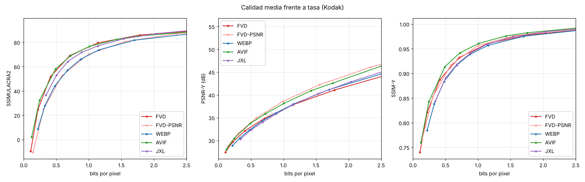

# Resultados del banco de pruebas

Kodak (24 imágenes, 768×512). WebP: libwebp 1.6.0 `method=6`. AVIF: libavif 1.4.2 (aom) `speed=4`, 4:2:0. JPEG XL: libjxl 0.7 vía ffmpeg, `effort=7`. FVD: perfil por defecto (perceptual) y `--tune psnr`. Métricas calculadas con `fvd compare` para todos los códecs.

Imágenes: 24. BD-rate frente a **WebP** (negativo = menos bytes a igual calidad).

| Códec | SSIMULACRA2 | PSNR-Y | SSIM-Y | PSNR RGB | Cod. (s/img) | Dec. (s/img) |
|---|---|---|---|---|---|---|
| FVD | -29.1 % | -2.7 % | -13.9 % | -14.5 % | 1.80 | 0.054 |
| FVD-PSNR | -3.3 % | -23.3 % | -16.4 % | -22.9 % | 1.87 | 0.050 |
| WEBP | +0.0 % | +0.0 % | +0.0 % | +0.0 % | 0.12 | 0.114 |
| AVIF | -24.8 % | -16.4 % | -22.1 % | -17.4 % | 1.85 | 0.210 |
| JXL | -13.1 % | +2.5 % | -2.2 % | +11.8 % | 0.20 | 0.147 |

Rangos de integración BD: {'ssimulacra2': (30, 90), 'psnr_y': (28, 48), 'ssim_y': (0.85, 0.995), 'psnr': (26, 46)}

