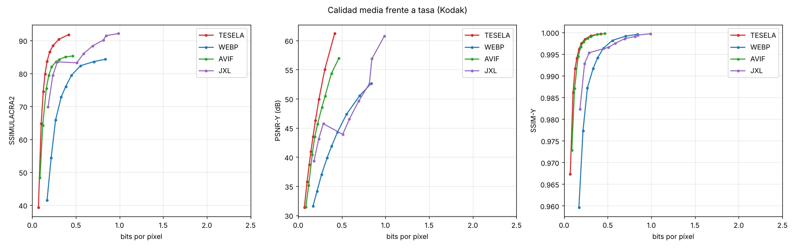

# Resultados del banco de pruebas

Imágenes: 9. BD-rate frente a **WebP** (negativo = menos bytes a igual calidad).

| Códec | SSIMULACRA2 | SSIMULACRA2 alta calidad | PSNR-Y | SSIM-Y | PSNR RGB | Cod. (s/img) | Dec. (s/img) |
|---|---|---|---|---|---|---|---|
| TESELA | -57.9 % | -62.3 % | -54.5 % | -56.4 % | -59.0 % | 5.10 | 0.105 |
| WEBP | +0.0 % | +0.0 % | +0.0 % | +0.0 % | +0.0 % | 0.21 | 0.124 |
| AVIF | -50.6 % | -53.2 % | -47.5 % | -51.2 % | -48.2 % | 3.99 | 0.175 |
| JXL | -36.0 % | -36.0 % | -2.4 % | -5.3 % | -12.4 % | 0.60 | 0.207 |

Rangos de calidad sobre los que se integra el BD-rate: ssimulacra2: 30–90, ssimulacra2_hq: 70–90, psnr_y: 28–48, ssim_y: 0.85–0.995, psnr: 26–46.

