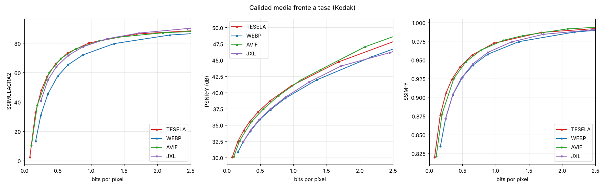

# Resultados del banco de pruebas

CLIC 2020, validación «professional»: 41 fotos (2,2 MP de media), conjunto de referencia del Challenge on Learned Image Compression. Ninguna se usó para ajustar ni entrenar Tesela. Todos los códecs sin metadatos.

Imágenes: 41. BD-rate frente a **WebP** (negativo = menos bytes a igual calidad).

| Códec | SSIMULACRA2 | SSIMULACRA2 alta calidad | PSNR-Y | SSIM-Y | PSNR RGB | Cod. (s/img) | Dec. (s/img) |
|---|---|---|---|---|---|---|---|
| TESELA | -35.3 % | -32.8 % | -25.5 % | -31.9 % | -33.0 % | 14.74 | 0.570 |
| WEBP | +0.0 % | +0.0 % | +0.0 % | +0.0 % | +0.0 % | 0.49 | 0.514 |
| AVIF | -28.5 % | -27.0 % | -19.7 % | -25.6 % | -20.9 % | 7.32 | 1.112 |
| JXL | -22.2 % | -26.1 % | -0.1 % | -7.8 % | -0.9 % | 0.93 | 0.784 |

Rangos de calidad sobre los que se integra el BD-rate: ssimulacra2: 30–90, ssimulacra2_hq: 70–90, psnr_y: 28–48, ssim_y: 0.85–0.995, psnr: 26–46.

