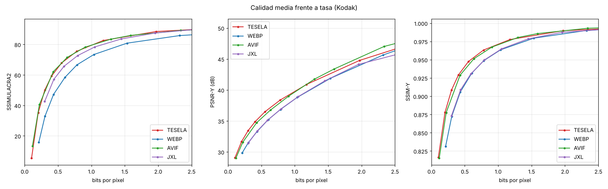

# Resultados del banco de pruebas

DIV2K: 50 de las 100 fotos de validación (2,7 MP). Ninguna se usó para ajustar ni entrenar Tesela. AVIF con croma 4:4:4.

Imágenes: 50. BD-rate frente a **WebP** (negativo = menos bytes a igual calidad).

| Códec | SSIMULACRA2 | SSIMULACRA2 alta calidad | PSNR-Y | SSIM-Y | PSNR RGB | Cod. (s/img) | Dec. (s/img) |
|---|---|---|---|---|---|---|---|
| TESELA | -36.5 % | -34.4 % | -23.1 % | -32.1 % | -35.9 % | 19.29 | 0.756 |
| WEBP | +0.0 % | +0.0 % | +0.0 % | +0.0 % | +0.0 % | 0.91 | 0.911 |
| AVIF | -34.4 % | -30.9 % | -18.3 % | -26.5 % | -28.5 % | 16.82 | 1.880 |
| JXL | -20.3 % | -21.0 % | +2.7 % | -4.7 % | +7.1 % | 1.05 | 0.851 |

Rangos de calidad sobre los que se integra el BD-rate: ssimulacra2: 30–90, ssimulacra2_hq: 70–90, psnr_y: 28–48, ssim_y: 0.85–0.995, psnr: 26–46.

