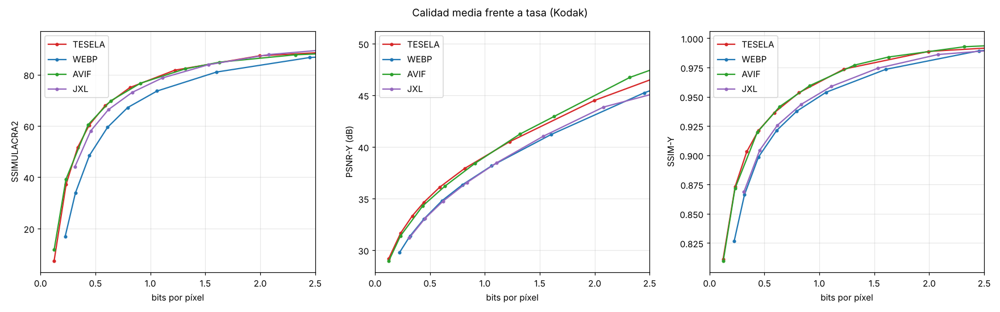

# Resultados del banco de pruebas

Imágenes: 12. BD-rate frente a **WebP** (negativo = menos bytes a igual calidad).

| Códec | SSIMULACRA2 | SSIMULACRA2 alta calidad | PSNR-Y | SSIM-Y | PSNR RGB | Cod. (s/img) | Dec. (s/img) |
|---|---|---|---|---|---|---|---|
| TESELA | -32.4 % | -27.9 % | -22.2 % | -28.7 % | -26.3 % | 10.09 | 0.468 |
| WEBP | +0.0 % | +0.0 % | +0.0 % | +0.0 % | +0.0 % | 0.84 | 0.878 |
| AVIF | -30.2 % | -23.5 % | -20.7 % | -26.6 % | -20.2 % | 18.58 | 2.360 |
| JXL | -21.2 % | -20.8 % | +0.7 % | -6.0 % | +7.4 % | 1.28 | 1.067 |

Rangos de calidad sobre los que se integra el BD-rate: ssimulacra2: 30–90, ssimulacra2_hq: 70–90, psnr_y: 28–48, ssim_y: 0.85–0.995, psnr: 26–46.

