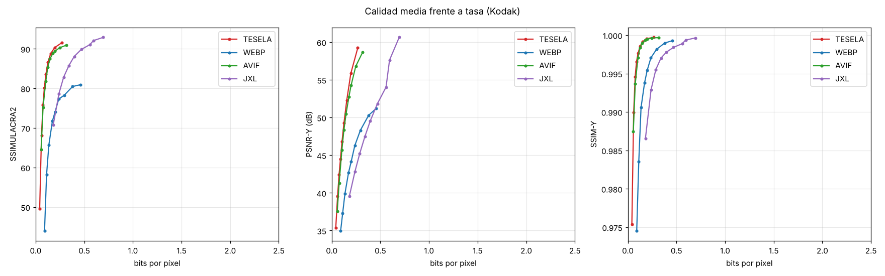

# Resultados del banco de pruebas

Imágenes: 6. BD-rate frente a **WebP** (negativo = menos bytes a igual calidad).

| Códec | SSIMULACRA2 | SSIMULACRA2 alta calidad | PSNR-Y | SSIM-Y | PSNR RGB | Cod. (s/img) | Dec. (s/img) |
|---|---|---|---|---|---|---|---|
| TESELA | -61.8 % | -64.1 % | -56.1 % | -58.7 % | -69.6 % | 4.39 | 0.125 |
| WEBP | +0.0 % | +0.0 % | +0.0 % | +0.0 % | +0.0 % | 0.12 | 0.079 |
| AVIF | -56.0 % | -58.0 % | -49.0 % | -53.9 % | -61.7 % | 3.26 | 0.098 |
| JXL | +9.5 % | +7.3 % | +39.8 % | +47.9 % | +21.1 % | 0.49 | 0.198 |

Rangos de calidad sobre los que se integra el BD-rate: ssimulacra2: 30–90, ssimulacra2_hq: 70–90, psnr_y: 28–48, ssim_y: 0.85–0.995, psnr: 26–46.

